# 分析の流れと、対象を分解する考え方

Analyzer がソースコードからアタックサーフェスを列挙するとき、何をどの順に分解し、どこで漏れを検出しているかを説明します。
手順書（[SKILL.md](../.claude/skills/attack-surface/SKILL.md)）は Claude 向けの指示です。この文書は、利用者と改修する人が設計の理由を追うためのものです。

## 目次

1. [列挙する対象を 3 つの層に分ける](#1-列挙する対象を-3-つの層に分ける)
2. [全体の流れ](#2-全体の流れ)
3. [入力を分解する](#3-入力を分解する)
4. [パス 1: ファイルを起点に全部読む](#4-パス-1-ファイルを起点に全部読む)
5. [穴を機械的に検出する](#5-穴を機械的に検出する)
6. [パス 2: 観点を起点に探し直す](#6-パス-2-観点を起点に探し直す)
7. [同じ対象かどうかを判定する](#7-同じ対象かどうかを判定する)
8. [3 つの層をつなぐ](#8-3-つの層をつなぐ)
9. [統合し、根拠を照合する](#9-統合し根拠を照合する)
10. [成果物を生成する](#10-成果物を生成する)
11. [知識ベースの使い方](#11-知識ベースの使い方)
12. [サンプルでの実測](#12-サンプルでの実測)
13. [この方式で分からないこと](#13-この方式で分からないこと)

---

## 1. 列挙する対象を 3 つの層に分ける

エンドポイントの一覧は「どこに送るか」を示します。診断には「何を送ると、どの処理が動くか」も必要です。
Analyzer は対象を次の 3 層に分けて記録します。

| 層 | 答える問い | 記録の単位 | 例 |
|---|---|---|---|
| 入口 | 外部からの入力はどこに届くか | メソッドとパス、イベント名、ポート番号 | `POST /api/v1/users/{id}/avatar`、キュー `thumbnails`、`5432/tcp` |
| 受け口 | 開発者のコードが動く前に、基盤は何を受け取るか | 仕組みと適用範囲 | 全ルートに掛かる本文パーサー、信頼されるヘッダー、Cookie の復元 |
| 解釈点 | 受け取った値は、どの処理に解釈されるか | 呼び出しの行と、値が届く入口 | `yaml.load`、zip の展開、画像変換、外部コマンド |

受け口と解釈点を分ける基準は 1 つです。
フレームワークやミドルウェアが開発者のコードより前に値を受け取る仕組みは受け口です。
特定の行で値がパーサーやコマンドに渡される呼び出しは解釈点です。

1 つのリクエストは、次の順に 3 層を通ります。

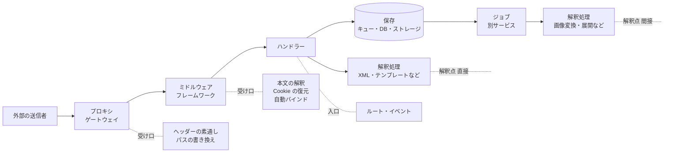

*図 1: リクエストが通る場所と、3 層の対応。実線は値の流れ、点線は各層として記録する場所を示す。*

図の右下にある解釈処理は、ハンドラーのコードからは見えません。
値がいったん保存され、別の場所で解釈されるためです。
この種の解釈点には、値が届く入口（`fed_by`）と、届き方が間接であること（`reach: indirect`）を記録します。

## 2. 全体の流れ

調査は 8 つの手順で進みます。判断をするのは Claude で、スクリプトは棚卸し・照合・統合・表の生成だけを行います。

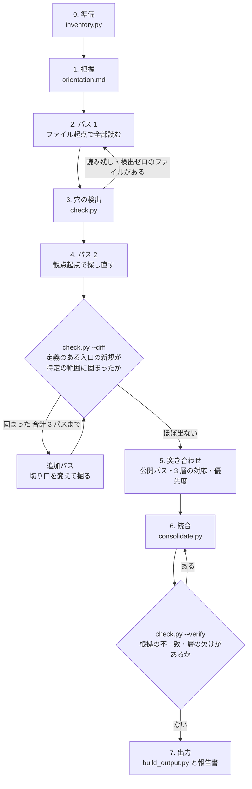

*図 2: 手順の順序と、前の手順へ戻る条件。ひし形は機械的な検査の結果による分岐を示す。*

2 回の調査は、起点を変えてあります。

| | パス 1 | パス 2 |
|---|---|---|
| 起点 | ファイル | 観点（レンズ） |
| 進め方 | 割り当てられた全ファイルを順に読む | 検索で当たりを付け、開いて読み、そこから辿る |
| 拾えるもの | 想定外の場所にある定義、未知のフレームワークのルート | ファイルをまたぐ関係、暗黙の仕組み、認証の境界 |
| 落としやすいもの | ファイルの外に答えがある事柄（マウント先、設定値の出どころ） | 検索語に掛からない独自の仕組み |
| 互いの結果 | — | パス 1 の一覧を渡さない |

パス 2 の担当者にパス 1 の一覧を渡さない理由は、独立性です。
既知の一覧があると、作業が「一覧の確認」に変わり、一覧に無いものを探さなくなります。

## 3. 入力を分解する

`inventory.py` は入力を次の順に分けます。

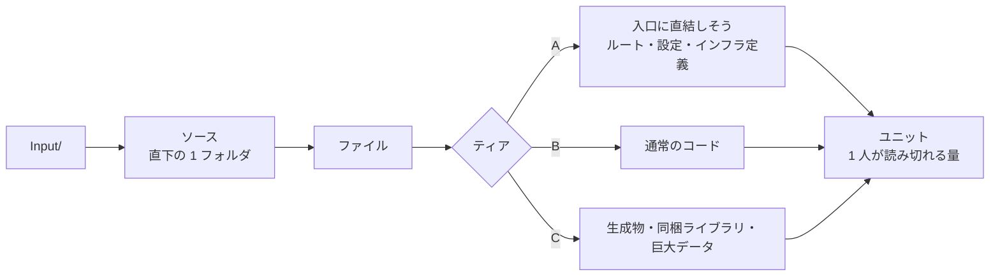

*図 3: 入力の分解。ティアは読み方の目安で、対象から外す判定ではない。*

ティアは、読み方を決める区分です。実在のリポジトリでは、量の大半を翻訳・テスト用データ・ロックファイル・画像が占めます。
実在の OSS 15 件で前後を測ると、読む量の見込みは、範囲を定義する前の 8〜86% になりました（Miniflux は 157 万トークンから 60 万トークン、Paperless-ngx は 1,737 万から 136 万）。
この差には、テストコードと文書を流し読み（C）に分けた分も含みます。

| ティア | 読み方 | 入るもの |
|---|---|---|
| A / B | 全文を読む | コード、設定、インフラ定義、依存定義、API 仕様 |
| C | 流し読み | テストコード、文書、同梱ライブラリ、マイグレーション、生成物 |
| D | 開かない。読み手に割り当てない | 翻訳、テスト用のデータ、変更履歴、ロックファイル、スナップショット、バイナリ |

D に分けることは、見落としと引き換えです。次の 4 段で守ります。

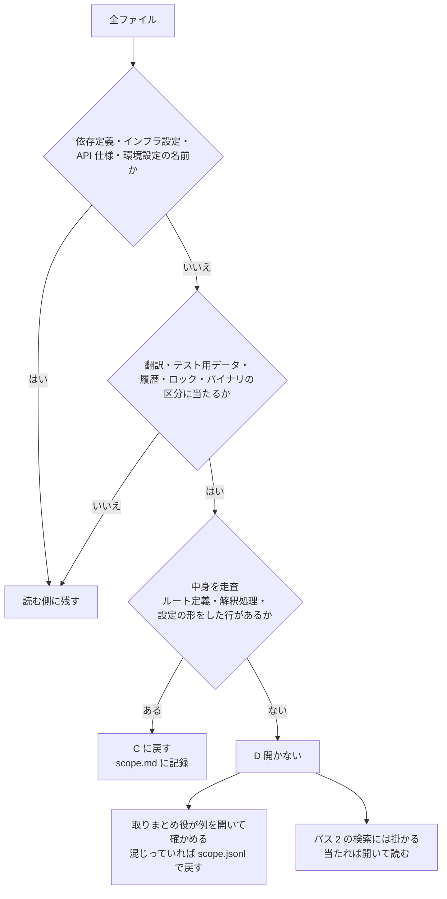

*図 3a: 開かない区分に分けるまでの判定と、分けた後の確認。*

翻訳は、置き場所の名前だけでは判定しません。翻訳らしい名前のディレクトリの下に、言語コードの名前が 3 つ以上並んでいる場合だけ翻訳とみなします。
走査の方法は、ファイルの種類で変えます。コードの拡張子には、ルート定義と解釈処理の目印を当てます。
データの拡張子（JSON、YAML、XML など）には、`path` や `url` のキーにパスが並ぶ「ルート表の形」と、プロキシやポートの設定の語を当てます。

| 単位 | 決め方 | 使い道 |
|---|---|---|
| ソース | `Input/` 直下の 1 フォルダまたは 1 アーカイブ | 項目の `source` 欄。ソース間の関係を調べる単位 |
| ティア | ファイル名・拡張子・置き場所 | A・B は全文を読む。C は冒頭と構造を見て、関係しないと判断した理由を記録する |
| ユニット | 既定で約 180KB または 60 ファイル。小さいソースは 1 つにまとめる | パス 1 の読み手 1 人の担当範囲 |

全ファイルは、ちょうど 1 つのユニットに入ります。
この対応があるので、後の検査で「誰も読んでいないファイル」を数えられます。

読む量の見込みから、規模の区分と人数が決まります。

| 規模 | 見込みトークン | パス 1 | パス 2 |
|---|---|---|---|
| 小 | 6 万未満 | 取りまとめ役が全部読む | 探し手 3 人 |
| 中 | 60 万未満 | ユニットごとに読み手 1 人 | 探し手 6 人 |
| 大 | 60 万以上 | ユニットごとに読み手 1 人 | レンズごとに 1 人 |

## 4. パス 1: ファイルを起点に全部読む

読み手は、担当ユニットの全ファイルを開き、次の 3 種類を記録します。

- 入口。HTTP のルートに加え、WebSocket、RPC、キュー、定期ジョブ、ポート、管理コマンドを含みます
- 受け口。ミドルウェアやフレームワークの設定が、どの形式の本文・ヘッダー・Cookie を読むか
- 解釈点。デシリアライズ、XML、テンプレート、外部コマンド、画像や文書の変換、アーカイブの展開

各項目には、ファイル・行・その行の引用を付けます。入口には、認証の状況とパラメーターも付けます。

パラメーターは、仕様書や実通信が無い前提で、コードから読める範囲を具体的に書きます。

| 読む場所 | 分かること | 記録の例 |
|---|---|---|
| 検証スキーマ、DTO、シリアライザー、型定義 | 項目名、型、必須かどうか | `body: email*(string)` |
| ハンドラーが値を読む行 | スキーマに無いのに読まれている項目 | `body: role?`（必須かどうかは不明） |
| 本文を丸ごと別の処理へ渡す行 | 一括代入、そのままの保存や転送 | `body: *` |
| ミドルウェアが読むヘッダーと Cookie | ルート定義に現れない入力 | `header: X-Tenant` |
| 呼ぶ側のコード | 実際に送られている項目 | `query: page, limit` |

必須かどうかがコードから分からない項目には、必須の印を付けません。一覧では `?` が付きます。
画面の項目には、その画面のコードから呼ばれる API を記録します。この記録が 10 章のサイトマップになります。

読み手は成果物を 3 つ書きます。

| ファイル | 内容 | 後で使う場面 |
|---|---|---|
| `findings.jsonl` | 検出項目。1 行 1 件 | 突き合わせと統合 |
| `coverage.jsonl` | 担当した全ファイルの読了状況（全読・流し読み・読まず）と理由 | 読み残しの検出 |
| `leads.md` | ユニットの外に答えがある事柄、不審な記述、コメントアウトされた入口 | 手順 3 と 5 で取りまとめ役が追う |

パス 1 では、フレームワークが暗黙に生やすエンドポイントを列挙しません。
読み手ごとに書くと粒度が揃わず、同じ管理画面を複数の人が別の数え方で記録するためです。
暗黙の仕組みは、パス 2 の専用レンズがソースを横断して調べます。

## 5. 穴を機械的に検出する

`check.py` は、記録と入力を照らし合わせ、見落としの候補を挙げます。
候補を採るかどうかは Claude が該当箇所を読んで決めます。

| 検査 | 照らし合わせるもの | 挙げるもの |
|---|---|---|
| 1. 成果物 | ユニット一覧と、提出されたファイル | 成果物の無いユニット |
| 2. 読了 | 棚卸しの全ファイルと、読了記録 | 誰も読んでいないファイル。ティア A・B なのに全読していないファイル |
| 3. 入口らしい記述 | ルート定義・注釈・ファイル規約のパターンと、根拠に現れたファイル | 該当する行があるのに、検出項目が 1 件も無いファイル |
| 4. 解釈処理らしい記述 | デシリアライズ・外部コマンド・変換などのパターンと、根拠に現れたファイル | 検出項目が無いファイル。検出はあるが、該当行の前後 3 行に受け口・解釈点の根拠が無い行 |
| 5a. 部品 | 依存定義・イメージ名と、知識ベースの解釈部品 | 受け口・解釈点の項目に一度も出てこない部品 |
| 5b. 暗黙のエンドポイント | 依存定義・記述と、知識ベースのエンドポイント | 検出項目に一度も出てこない項目 |
| 5c. 仕様書 | 入力にある OpenAPI / Swagger のメソッドとパスと、検出項目 | 仕様にあるのに一覧に無い操作。コードに定義があるのに仕様に無い入口 |
| 6. 証跡 | 項目の引用と、実際のファイルの該当行の前後 3 行 | 存在しないファイル、範囲外の行、一致しない引用 |
| 7. 秘密情報 | 項目の全文と、資格情報のパターン | 値が書き写されている項目 |

検査 3 と 4 のパターンは緩く作ってあり、誤って挙がる行があります。
パターンは「読み直す場所の候補」を出すためのもので、検出項目そのものは生成しません。

検査 5c は、入力に仕様書があるときだけ動きます。仕様書は JSON と YAML の両方から読み取ります。
仕様にしかない操作は、実装が入力に無くても `SPEC_ONLY` を付けて一覧に残します。

検査 4 の行単位の判定は、次の見落としに対応します。
あるファイルのルートは記録したが、同じファイルにある `res.download(req.query.file)` を解釈点として記録しなかった、という場合です。
ファイル単位の判定では、検出項目が 1 件でもあれば検査を通過していました。

## 6. パス 2: 観点を起点に探し直す

パス 2 は 11 個のレンズで構成されます。各レンズは、パス 1 の読み方では届きにくい場所を 1 つずつ担当します。

| レンズ | 層 | 探し方 |
|---|---|---|
| `entry` | 入口 | 起動の入口からルーターの登録を連鎖的に辿り、マウントの接頭辞を確定する |
| `implicit` | 入口 | 依存とイメージから、既定で存在するエンドポイントを挙げ、設定で無効になっていないかを読む |
| `client` | 入口 | 呼ぶ側のコード（フロント、テスト、文書の例）から呼び出し先を集め、サーバー側の定義と照合する |
| `infra` | 入口 | プロキシ、コンテナ、クラウドの定義から、公開ポート・ホスト名・転送先を挙げる |
| `nonhttp` | 入口 | WebSocket、キュー、定期ジョブ、RPC、管理コマンドを探す |
| `leftover` | 入口 | デバッグ用の口、旧版の API、テスト専用の経路を探す |
| `authz` | 入口 | 認証・認可の処理を読み、掛かっていないルートと、中身が空のガードを探す |
| `intake` | 受け口 | リクエストがハンドラーに届くまでの道筋を全部読む |
| `parsers` | 解釈点 | 解釈処理を全部見つけてから、誰が値を届けられるかを遡る |
| `assumptions` | 受け口・解釈点 | 開発者の前提（「ここには内部からしか来ない」など）を列挙し、破る経路を探す |
| `open` | 全部 | 観点を指定せず、上の 10 個が想定していないものを探す |

`parsers` レンズは、入口から辿る方向と逆に進みます。

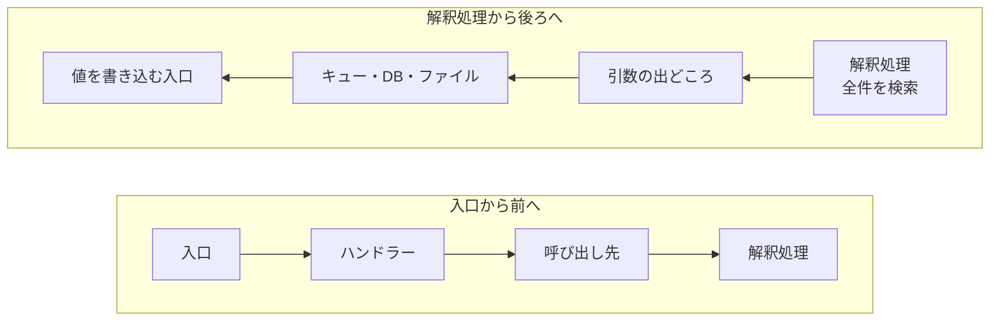

*図 4: 解釈点を見つける 2 つの方向。入口から辿る方向は、ジョブや別サービスの中にある解釈処理に届かない。*

片方の方向でしか見つからなかった解釈点は、値が届く経路を確定できていません。
その場合は項目を外さず、フラグ `REACH_UNKNOWN` を付けて残します。

パス 2 の後、`check.py --diff` がパス間の差を数えます。新規は 2 種類に分けて表示します。

| 新規の種類 | 意味 | 収束の判断に使うか |
|---|---|---|
| コードや設定に定義のあるもの | パス 1 の取りこぼし | 使う。入口の新規が特定のソースや種別に 5 件以上固まれば、その範囲をもう一度掘る |
| 暗黙の仕組み | パス 1 の対象外 | 使わない |

## 7. 同じ対象かどうかを判定する

複数の担当者が同じ対象を別の書き方で記録します。
旧版の実走テストでは、パス 2 の新規が 74 件と表示され、そのうち実際の新規は 6 件でした。残りは書き方の違いです。
現在の照合は、種別ごとに次の規則で判定します。

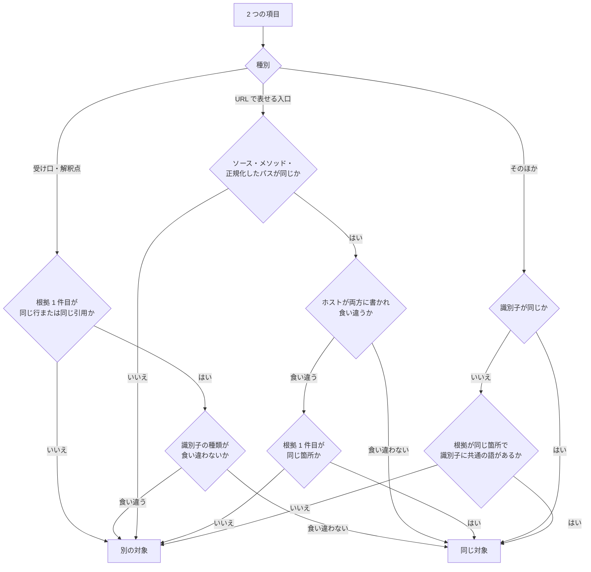

*図 5: 同じ対象とみなす判定の流れ。「そのほか」は RPC、ジョブ、Server Action、資格情報の所在など。*

判定の前に、書き方を揃える正規化を行います。

| 対象 | 正規化 | 例 |
|---|---|---|
| パスの可変部分 | `{name}` に揃える | `/users/:id`、`/users/<int:id>` → `/users/{id}` |
| 末尾のスラッシュ | 照合では無視する | `/health/` と `/health` |
| ポート | `番号/プロトコル` に揃える | `db:5432/tcp` → `5432/tcp` |
| ホスト名の項目 | スキームとポートを外す | `https://shop.example.co.jp` → `shop.example.co.jp` |
| ホスト欄 | ホスト名 1 つを取り出し、説明は備考へ移す | `(Docker ホスト):8025` → 空欄と備考 |

ホストだけが違う 2 つの入口は、根拠の位置で区別します。
本番と検証のサーバー定義が別の行にあれば、同じパスでも別の対象として残ります。
1 つの定義が複数のホストで公開されているだけなら、1 件にまとめ、ほかのホストを併記します。

受け口と解釈点の識別子は `種類:詳細` の形で書きます（`body:json`、`xml:xml2js@routes/import.js`）。
依存の宣言行は、1 行が複数の仕組みの根拠になります。
たとえば `"next": "14.2.0"` の 1 行から、Server Actions、画像最適化、Middleware の内部ヘッダーが生じます。
宣言行を根拠にした項目は、種類が一致するものだけを同じ対象とみなします。

## 8. 3 つの層をつなぐ

手順 5 では、取りまとめ役がソースをまたいで読み、項目どうしを対応づけます。

| 対応づけ | 記録する欄 | 判断の材料 |
|---|---|---|
| 入口 → 公開パス | `path`、`internal_path`、`host` | プロキシやゲートウェイの転送設定 |
| 解釈点 → 値が届く入口 | `fed_by`、`reach` | ハンドラーからの呼び出し、キューへの投入、共有ストレージへの書き込み |
| 入口 → 届く解釈点 | `reaches` | 上の逆引き |
| 受け口 → 掛かる範囲 | `scope` | ミドルウェアの登録位置と順序 |
| 呼ぶ側 → 受ける側 | フラグ | クライアントのコード、仕様書、テスト |

対応づけの結果は、フラグとして項目に残ります。

| フラグ | 条件 |
|---|---|
| `IMPLICIT` | コードに定義が無く、フレームワークやミドルウェアが生やしている |
| `UNINTENDED_INTAKE` | 開発者のコードが読んでいないのに、基盤が受け取っている |
| `PRE_AUTH` | 認証より前に動く |
| `SECOND_ORDER` | 保存や中継の後で解釈される |
| `REACH_UNKNOWN` | 解釈点に値が届く経路を確定できなかった |
| `UNREFERENCED` | 入力にあるどのクライアントからも呼ばれていない |
| `SHADOW` | 呼ばれているが、受ける側が入力に無い |
| `AUTH_CONFLICT` | 担当者の間で、認証の要否の判断が食い違った |

`SHADOW` が特定のホストやパスに集まる場合、渡されていないリポジトリがあると推定できます。
推定は `coverage.md` の「入力に足りないと思われるもの」に書きます。

## 9. 統合し、根拠を照合する

`consolidate.py` は、全パスの記録を次の順に処理します。

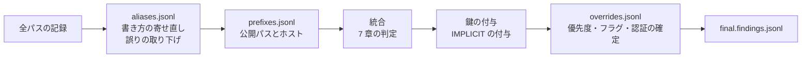

*図 6: 統合の処理順。補助ファイル 3 つは Claude が判断を書き込む場所で、無ければ飛ばす。*

Claude は、判断を補助ファイルに書きます。記録そのものは書き換えません。
補助ファイルを直して統合を再実行すれば、同じ結果を再現できます。

統合で値が食い違った場合の扱いは次のとおりです。

| 欄 | 扱い |
|---|---|
| 根拠、タグ、発見元、`fed_by`、`reaches` | 合算する |
| 確度、優先度 | 高いほうを採る |
| パラメーター | 名前と場所が同じ項目は 1 つにし、片方にしか無い情報（必須か、型）を補う |
| 備考 | 言い換えを除き、3 件・600 字まで |
| 認証 | 証拠のある判断を採る。「あり」と「なし」が食い違えば両方の根拠を残し、`AUTH_CONFLICT` を付ける |

`AUTH_CONFLICT` は、中身が空の認証ガードを見つける手がかりになります。
ガードが付いていることを見て「あり」とした担当者と、ガードの中身を読んで「なし」とした担当者の判断が割れるためです。

`check.py --verify` は、確定した一覧に対して最終の照合を行います。

- 全項目の引用が、記録されたファイルと行の前後 3 行にあるか
- リクエストを受ける入口があるのに、受け口が 1 件も無いソースがあるか
- 値が届く入口が書かれていない解釈点があるか
- 値を受け取るメソッドなのに、パラメーターが書かれていない入口があるか
- 知識ベースに手がかりがあるのに、載っていない部品やエンドポイントがあるか

## 10. 成果物を生成する

`build_output.py` は、確定した一覧（`final.findings.jsonl`）から成果物を生成します。
この段階で Claude の判断は入りません。同じ一覧からは、常に同じ成果物ができます。

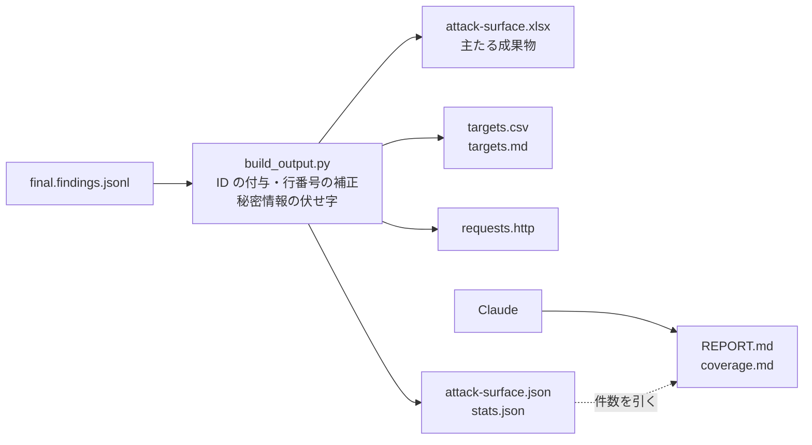

*図 7: 成果物の生成。実線はスクリプトが生成するもの。報告書だけは Claude が書き、件数は `stats.json` から引く。*

Excel ブックのシートは、3 層に対応させてあります。

| シート | 元になる項目 | 主な列 |
|---|---|---|
| 概要 | 件数の集計 | ソース別・層別の件数、各シートの説明 |
| 対象一覧 | 入口 | 優先度、ホスト、Method、パス、パラメーター、認証とその根拠、フラグ、届く解釈点、根拠 |
| 受け口 | 受け口 | 掛かる範囲、受け取るもの、部品とバージョン |
| 解釈点 | 解釈点 | 何を解釈するか、部品とバージョン、届く入口、届き方 |
| サイトマップ | 画面の項目と、その呼び出し先 | 画面のパス、呼び出す API の ID |
| リクエスト | HTTP で送れる入口 | リクエストのひな形 |
| 凡例 | — | フラグと記号の意味 |

対象一覧の ID は「リクエスト」の該当行へ、リクエストとサイトマップの ID は対象一覧の該当行へリンクします。
ブックは Python の標準ライブラリだけで書き出します。Excel 用のパッケージは使いません。

リクエストのひな形は、パラメーターの記録から機械的に組み立てます。

| パラメーターの場所 | ひな形での置き方 |
|---|---|
| `path` | パスの `{id}` をそのまま残す |
| `query` | `?name={{name}}` として URL に付ける |
| `header`、`cookie` | ヘッダー行にする |
| `body` | JSON の本文にする。`address.zip` は入れ子に、`items[].sku` は配列にする |
| `form` | `application/x-www-form-urlencoded` の本文にする |
| `file` | `multipart/form-data` の本文にする |

値は型に応じた仮の値です。実際に通る値は含みません。
ひな形は、診断員が実通信を取りにいくときの出発点として使います。

サイトマップは、画面の項目に記録された呼び出し先を、一覧の ID に結んで作ります。
照合はメソッドと正規化したパスで行い、公開パスとソース内のパスの両方を見ます。
一覧に見つからない呼び出し先は「未対応」と表示します。受ける側が入力に無いか、書き方が違う場合です。

## 11. 知識ベースの使い方

知識ベースは 2 つあります。項目数は 2026 年 11 月時点の値です。

| ファイル | 内容 | 項目数 |
|---|---|---|
| `implicit-endpoints.json` | 依存・イメージ・記述から、既定で存在し得るエンドポイント | 106 項目、381 エンドポイント |
| `parser-components.json` | 依存から、受け取りと解釈を担う部品 | 53 部品 |

2 つの合計は約 12 万字あります。担当者全員が通読すると、小さい入力でも読む量の大半を知識ベースが占めます。
そこで `inventory.py` が、入力に手がかりのある項目だけを `work/knowledge.md` に抜き出します。

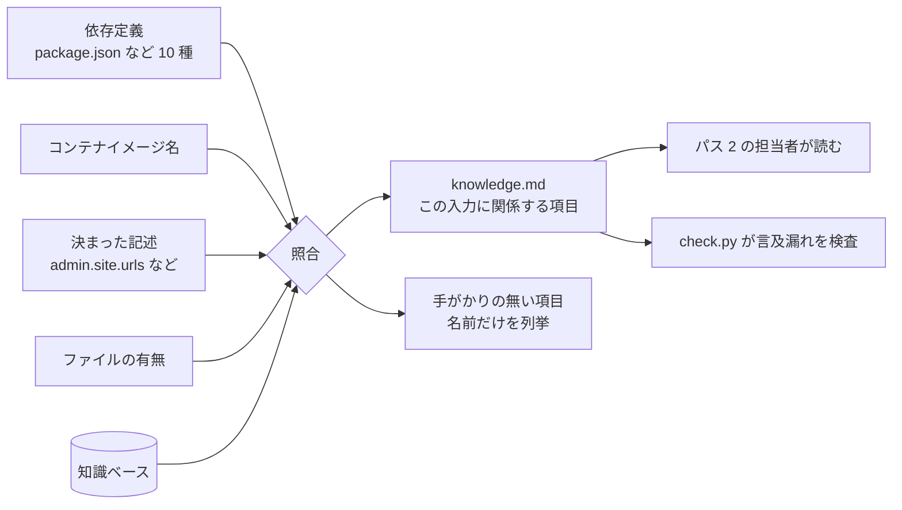

*図 8: 知識ベースの抜粋。同じ照合結果を、担当者への資料と機械検査の両方に使う。*

抜粋に載る項目は「存在し得る」候補です。設定で無効になっていないかは、担当者が読んで確かめます。
抜粋に載らない依存については、担当者が自分の知識で補います。知識ベースは網羅していません。

## 12. サンプルでの実測

次の数値は、開発中に用意した架空のシステムを対象にした実走テスト 1 回の結果です。
入力は 4 ソース・37 ファイル・約 15KB で、意図的に問題を仕込んであります。
実在のリポジトリでの測定ではなく、テストの前半は改修前の手順で実行されました。

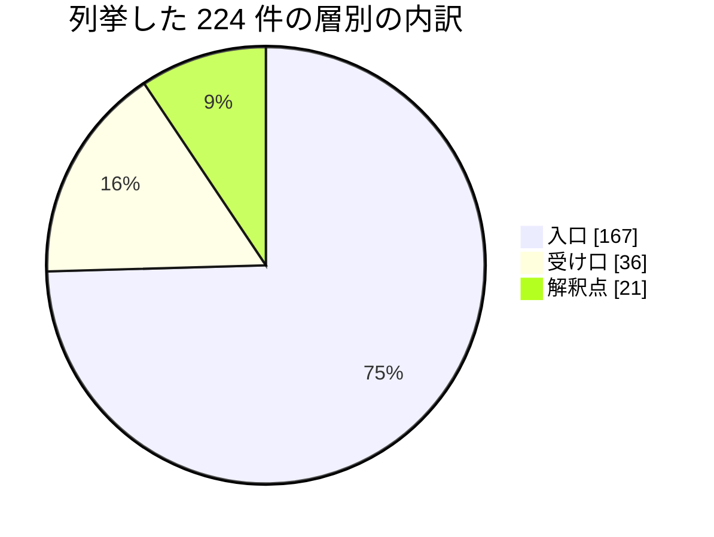

*図 9: 層別の件数。出所は当該テストの `stats.json`。*

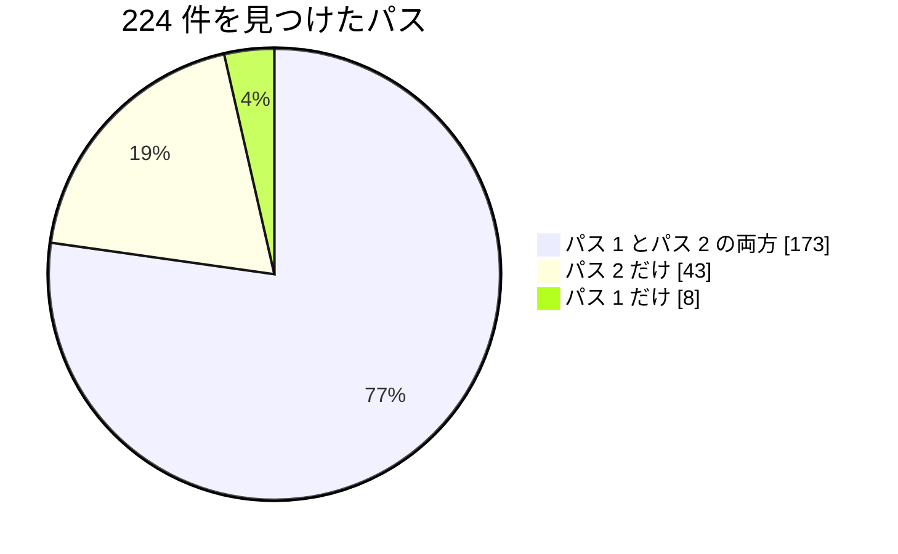

*図 10: どのパスが見つけたか。出所は当該テストの `stats.json`。*

パス 2 だけが見つけた 43 件の内訳は、入口 29・受け口 9・解釈点 5 です。
テスト担当の報告では、コードに定義のある入口でパス 1 が落としたものは 0 件でした。
43 件の主な中身は、暗黙のエンドポイントと、パス 1 が 1 件にまとめていた仕組みの細分です。

統合の件数は次のように推移しました。

| 段階 | 件数 | 条件 |
|---|---:|---|
| 全パスの記録 | 712 行 | 担当者 6 人分 |
| 自動の統合（改修前） | 290 件 | 補助ファイルは公開パスのみ |
| 自動の統合（改修後） | 264 件 | 同じ記録を改修後のスクリプトで再処理 |
| 補助ファイルの適用後 | 224 件 | 寄せ直し 268 行と取り下げ 14 件を適用（テスト時） |

改修後も 40 件の差が残ります。内訳は、取り下げ 14 件と、層の判断の割れや根拠の位置の違いです。
後者は `merge.md` に要確認として表示され、Claude が補助ファイルで解消します。

このテストで 3 層の枠組みが引き出した項目の例です。

| 項目 | 層 | 入口の一覧だけでは見えない理由 |
|---|---|---|
| ジョブの中で画像が sharp と exiftool に渡る | 解釈点（間接） | アップロードのハンドラーは保存してキューに入れるだけ。exiftool は依存定義に現れない |
| nginx に `proxy_set_header` が無く、ヘッダーが上流へ素通し | 受け口 | ルートではなく、設定が「無い」ことで生じる |
| 取引先フィードを `yaml.load` で読む | 解釈点（経路不明） | 受け取り経路が入力に無い |
| 認証ガードの中身が `next()` だけ | 入口の認証欄 | ガードの名前はルート定義に付いている |

所要時間は約 68 分でした。知識ベースの抜粋と人数の見直しは、このテストの後に入れた変更です。
変更後の所要時間とトークン数は測定していません。

パラメーターの詳細な記録、画面の呼び出し先、仕様書との照合、Excel の出力も、このテストの後に追加しました。
スクリプトの動作はテスト記録の再処理で確認しています。Claude が新しい指示どおりに記録するかは、実走では確認していません。

## 13. この方式で分からないこと

- **実行時に決まるもの。** 環境変数で切り替わる設定、実行時に登録されるルート、渡されていない設定ファイルの値は確定できません。確定できなかった点は `coverage.md` に書きます
- **入力に無いもの。** 渡されていないリポジトリやインフラ定義の中にある入口は列挙できません。`SHADOW` の偏りから存在を推定するところまでです
- **パラメーターの実際の値と応答。** コードから読めるのは項目名・場所・型・必須かどうかまでです。リクエストのひな形の値は仮です。実際に通る値と応答の形は、実通信で確かめる必要があります
- **脆弱性の有無。** 一覧は「診断で調べる場所」を示します。優先度は診断で先に見る価値で、脆弱であるという判定ではありません
- **既知の脆弱性との対応。** 部品とバージョンは記録しますが、該当する脆弱性の有無は照合しません。知識ベースにもバージョンの範囲は書いていません
- **知識ベースに無い仕組み。** 抜粋と言及漏れの検査は、知識ベースにある項目にしか効きません。それ以外は担当者の知識とコードの読解に依存します
